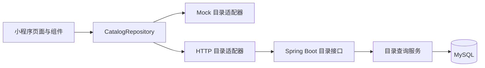

# 技术架构

项目使用微信小程序原生组件、TypeScript、Spring Boot 3、Java 17 和 MySQL。公开展示聚焦服务目录的读取链路。

## 页面与数据源

小程序组件接收已经整理的展示属性。服务卡片触发 `select` 事件并传递服务 ID，页面据此导航。搜索框传递用户输入，数据查询由使用目录契约的页面负责。

`CatalogRepository` 约定了游戏、分类、服务、陪练和首页数据的读取接口。Mock 适配器从本地快照挑选可展示数据，可模拟空列表和加载失败。HTTP 适配器校验返回结构，通过游戏和分类字典整理服务信息，并处理详情接口的 404。两种适配器使用相同的 TypeScript 展示类型。

## 目录数据约定

- ID 以字符串传递，避免前端在处理后端长整型标识时损失精度。
- 金额使用包含两位小数的字符串。起步价允许为空，组件可以显示「暂无可选服务」。
- 列表返回分页信息。详情包含服务说明及规格，规格提供各自的价格。
- 后端目录 Controller 负责解析请求参数并调用查询服务。有效性和公开范围最终由服务端查询规则决定。

## 浏览器演示

演示独立呈现目录筛选、搜索、无结果提示和规格详情。HTML、CSS 与 JavaScript 直接在浏览器运行，数据来自同一目录中的合成样例。演示不会建立用户会话或发起商用 API 请求。

公开仓库中的 Java、TypeScript 和小程序模板用于说明项目实现。演示的浏览器代码独立于原生小程序运行时。
